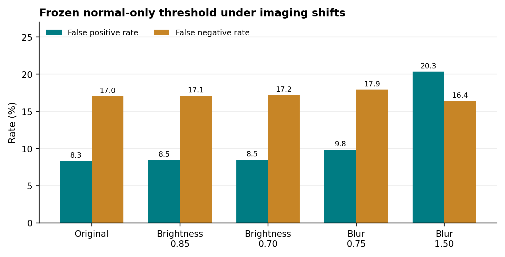

# Vision Foundation Models for Industrial Anomaly Detection

*Robustness and Reference Augmentation in One-Shot Learning*

**MSc thesis | Human-Centered Artificial Intelligence | Technical University of Denmark (DTU)**

How well can an industrial inspection system detect and localize defects using a single normal reference image? This thesis reproduces AnomalyDINO with frozen DINOv2 features on MVTec AD, evaluates its sensitivity to digital darkening and Gaussian blur, and tests whether reference augmentation can improve robustness without increasing the number of stored patch embeddings.

**Python · PyTorch · DINOv2 · FAISS · OpenCV · NumPy · DTU HPC / LSF**

[Results](#measured-results) · [Method](#method) · [Failure analysis](#failure-analysis) · [Explore the code](#explore-the-project) · [Reproducibility](#reproducibility)

> **Research status (27 November 2026):** The recorded experimental study comprises 45 clean runs, 180 perturbed evaluations, 900 fixed-budget ablation evaluations and 225 frozen-threshold comparisons. The empirical scope is one-shot detection; zero-shot methods are discussed as related work, not evaluated experimentally. The system is a research prototype, not a validated production inspection system.

## Research questions

| Research question | Experimental study |
|---|---|
| **RQ1.** How effectively does AnomalyDINO detect and localize industrial anomalies in a one-shot setting? | Baseline reproduction |
| **RQ2.** How do controlled brightness changes and Gaussian blur affect detection, localization and false-alarm rates? | Robustness analysis and normal-only threshold calibration |
| **RQ3.** Can augmenting the normal reference improve robustness at a fixed patch budget? | Reference augmentation and ablation study |

Each reference-selection run uses one original normal training image per category. Transformed views of that image are not additional independent references.

## Measured results

| Condition | Image AUROC | Image AP | Image F1-max | Pixel AUROC | Pixel F1-max | Pixel AUPRO |
|---|---:|---:|---:|---:|---:|---:|
| Clean | 96.52% | 98.14% | 95.96% | 96.26% | 57.94% | 91.72% |

**Evaluation:** MVTec AD, all 15 categories, 3 deterministic reference choices per category, 45 clean runs. Each run uses one normal reference, frozen DINOv2 ViT-S/14 and 448-pixel short-edge resizing. Metrics are averaged across the three reference choices and then across the 15 categories with equal weight. Pixel AUPRO is evaluated up to a pixel false-positive rate of 0.30. F1-max uses the best threshold for the evaluated scores; it is not a calibrated operating-point metric.

[Baseline metrics](reports/baseline_reproduction/summary.json) · [Category-level image AUROC](reports/baseline_reproduction/figures/image_auroc.svg) · [Pixel F1-max](reports/baseline_reproduction/figures/pixel_f1max.svg) · [Provenance](reports/baseline_reproduction/provenance.json)

### Robustness under lighting changes and blur


All 180 perturbed evaluations were completed with the same test images and reference identities as the clean baseline. The strongest blur (Pillow radius 1.50 pixels at the resized input scale) decreased image AUROC by **3.08 percentage points** and pixel AUPRO by **1.53 percentage points**. The tested brightness reductions produced much smaller aggregate changes. These are controlled synthetic perturbations, not a validation on factory production lines.

[Full results and six-metric table](reports/lighting_blur/README.md) · [Per-run CSV](reports/lighting_blur/per_run.csv) · [Category changes](reports/lighting_blur/per_category.csv) · [Protocol](protocols/lighting_blur.md)

## Method


AnomalyDINO (WACV 2025) uses a frozen DINOv2 encoder to extract dense patch embeddings from reference and test images. Normal reference embeddings form a memory bank. An exact CPU FAISS L2 index finds one nearest normal embedding per retained test patch. Unit-normalized features give cosine distance as half the squared L2 distance. Patch scores form an anomaly map, while averaging the highest-scoring one percent of patches gives the image-level score. No model weights are updated. The robustness experiments transform only test inputs, keeping the normal reference fixed.

The augmentation study builds on the original rotation augmentation in AnomalyDINO. It compares four banks: rotation-only, brightness, blur and combined augmentation. Each bank uses one original normal reference and exactly 8,192 stored patch embeddings. Matched variants share test features and masks. The rotation-only bank is a same-pipeline comparator, distinct from the archived baseline; all 225 matched comparisons were checked against the archive. The fixed budget controls the number of stored embeddings, not the complete computational cost.

### Fixed-budget reference augmentation


| Reference bank | Clean image AUROC | Strong-blur image AUROC | Strong-blur pixel AUPRO |
|---|---:|---:|---:|
| Rotation only | 96.52% | 93.44% | 90.19% |
| Brightness | 96.45% | 93.26% | 90.07% |
| **Blur** | **96.60%** | **94.98%** | **90.35%** |
| Combined | 96.52% | 94.88% | 90.30% |

Blur augmentation improves strong-blur image AUROC by **1.54 percentage points** and pixel AUPRO by **0.16 pp** at equal bank cardinality. The image-level gain occurs in 13 of 15 categories; Transistor contributes the largest gain (+14.04 pp). Excluding Transistor, the mean gain remains +0.65 pp. Clean AUPRO decreases by 0.10 pp, and some category-level localization effects are negative. The result is an empirical finding on MVTec AD, not evidence of statistical significance or generalization to another benchmark.

[All 900 evaluations](reports/reference_augmentation/per_run.csv) · [Macro metrics](reports/reference_augmentation/macro.csv) · [Ablation protocol](protocols/reference_augmentation.md) · [All figures and LaTeX tables](reports/publication_assets/)

### Frozen normal-only threshold calibration



For each reference choice, a threshold was calibrated on 40 additional normal training images per category, excluding all three reference images. All 45 thresholds were frozen before reading the archived test predictions for this retrospective operating-point analysis. Across 225 matched condition/reference comparisons, strong blur increased the macro false-positive rate from **8.32% to 20.34% (+12.02 pp)**. This is one-shot reference detection with additional normal calibration data, not strictly one-shot total data usage. Calibration evaluates the original baseline only; it does not establish that augmentation reduces operational false alarms.

[Threshold results](reports/threshold_calibration/summary.json) · [Calibration protocol](protocols/threshold_calibration.md)

## Failure analysis


Blur can raise a normal image's anomaly score and lower scores for real defects. These selected extreme cases are useful for diagnosis, but are not estimates of error rates. The separate frozen-threshold analysis above quantifies baseline operating errors. Two localized raw-map discrepancies in Screw under strong blur were recorded during archived-comparator verification; image-level metrics agree exactly, and the maximum per-run AUPRO discrepancy is 0.001012 pp.

[Selected measured cases](reports/lighting_blur/selected_blur_cases.csv) · [Final audit](reports/final_scientific_analysis/audit.json)

## Implementation and research skills

| Capability | Evidence |
| --- | --- |
| Computer vision & deep learning | Frozen ViT features, patch embeddings, anomaly localization |
| ML engineering | GPU inference, CPU metric evaluation, FAISS search, modular experiment scripts |
| Experimental design | Fixed reference manifests, paired controls, controlled perturbations |
| Scientific computing | AUROC, AP, F1-max, AUPRO, category-level variation and error analysis |
| Reproducibility | Pinned upstream code, environment records, reference hashes and result provenance |

## Explore the project

Five executed notebooks follow the research workflow, and three public Python scripts provide the entry points for experiments, evaluation and visualization. The retained implementation modules and historical commits preserve the original execution record.

```text
assets/         README graphics and their generator
notebooks/      Research workflow and analysis
scripts/        Three public Python entry points
implementation/ Retained experiment modules
protocols/      Experimental settings and reference manifests
reports/        Verified numerical results and publication assets
results/        Archived Bottle smoke-test outputs
research_logs/  Historical execution and provenance
configs/        Environment records
jobs/           HPC job definitions
third_party/    Pinned upstream AnomalyDINO implementation
```

| Notebook | What you will find |
|---|---|
| [Dataset exploration](notebooks/01_dataset_exploration.ipynb) | Official data splits, defect masks and reference checks |
| [Baseline reproduction](notebooks/02_baseline_reproduction.ipynb) | Setup, historical smoke test, 45 clean runs and paper comparison |
| [Robustness analysis](notebooks/03_robustness_analysis.ipynb) | All 180 perturbed evaluations |
| [Proposed improvement](notebooks/04_proposed_improvement.ipynb) | 900 matched fixed-budget ablation evaluations |
| [Final results](notebooks/05_final_results.ipynb) | Calibration, error analysis, limitations and synthesis |

| Public script | Purpose |
|---|---|
| [run_experiment.py](scripts/run_experiment.py) | Dispatch baseline, robustness, ablation and calibration inference |
| [evaluate.py](scripts/evaluate.py) | Dispatch evaluation and report aggregation |
| [visualize.py](scripts/visualize.py) | Generate eight publication figures and five LaTeX/CSV tables from published data |

The `results/` directory retains the original Bottle smoke-test evidence used by the baseline notebook; `reports/` contains the verified study summaries, per-run metrics and publication assets. Historical jobs and logs are provenance records, not launch instructions for the current checkout.

Supporting folders: [implementation](implementation/), [protocols](protocols/), [HPC jobs](jobs/), [reports](reports/), [research logs](research_logs/), [environment](configs/), and the pinned [AnomalyDINO submodule](third_party/AnomalyDINO).

## Reproducibility

### Reproduce the reported analysis (CPU)

The checked-in results allow readers to inspect the analysis and regenerate the publication assets without a GPU or DTU account. From a Python environment:

```bash
git clone https://github.com/basharbd/msc-visual-anomaly-detection.git
cd msc-visual-anomaly-detection
python -m pip install -r requirements.txt
python scripts/visualize.py --output outputs/publication_assets
jupyter notebook
```

The visualization command writes to a new directory, without overwriting the checked-in reports. Notebooks 02–05 call the shared plotting functions to generate their study figures; the checked-in PDF and PNG exports are the notebook-generated publication assets. See the [figure provenance and thesis mapping](reports/publication_assets/README.md). Choose another unused output directory for subsequent runs.

The dataset notebook requires a separately obtained official MVTec AD dataset (set `MVTEC_ROOT`); the other four notebooks read the checked-in CSV and JSON results. The numbered notebooks 02–05 were also re-executed successfully in a separate Python 3.11 CPU environment on 27 November 2026 after the documentation and validation-check updates. Notebook 01 was schema-validated but not re-executed in that environment because the official dataset was unavailable; its archived HPC outputs are retained. All five notebooks were executed and validated on DTU HPC after restructuring. The generated numerical tables matched the verified originals byte for byte. The reorganized evaluation CLI also rebuilt all 900 ablation and 225 threshold comparisons from archived HPC records, matching every numerical table within 1e-12.

### Replay the experiments (GPU/HPC)

For exact historical execution, see the [reproduction guide](REPRODUCIBILITY.md), the [pinned experiment commits](research_logs/night_run_30402340/README.md), the [900-row inference/evaluation hash manifest](research_logs/night_run_30402340/evaluation_manifest.csv), and the [original experiment protocols](protocols/). The full inference workflow uses the recorded DTU CUDA, cache and archive layout. The current public scripts accept an optional dataset root; the recorded DTU path remains the default. Raw maps and full dataset files remain on HPC. The reorganized entry points have not been independently GPU-replayed; original experimental commits remain authoritative for byte-level provenance.

## References and data use

- Damm et al., *AnomalyDINO: Boosting Patch-Based Few-Shot Anomaly Detection with DINOv2*, WACV 2025. [Paper](https://openaccess.thecvf.com/content/WACV2025/html/Damm_AnomalyDINO_Boosting_Patch-Based_Few-Shot_Anomaly_Detection_with_DINOv2_WACV_2025_paper.html)
- Oquab et al., *DINOv2: Learning Robust Visual Features without Supervision*. [Paper](https://arxiv.org/abs/2304.07193)
- Bergmann et al., *MVTec AD — A Comprehensive Real-World Dataset for Unsupervised Anomaly Detection*, CVPR 2019. [Official dataset and terms](https://www.mvtec.com/research-teaching/datasets/mvtec-ad)

MVTec AD data is licensed CC BY-NC-SA 4.0; the benchmark results are academic research and do not establish commercial dataset-use rights. The repository graphics use original schematics and numerical results rather than redistributing dataset images. Upstream code and weights retain their own licenses.

---

**Bashar Khaled Bdewi** · MSc Human-Centered Artificial Intelligence, DTU

[GitHub profile](https://github.com/basharbd)
