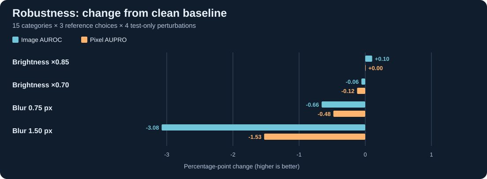
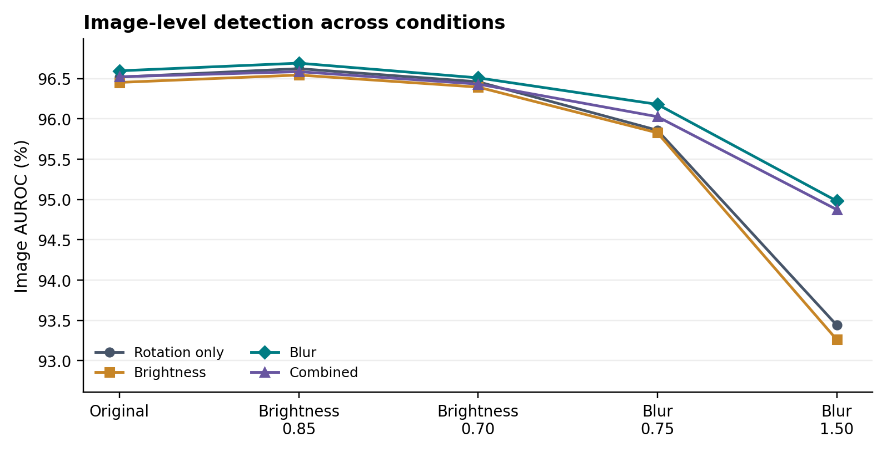

# Vision Foundation Models for Visual Anomaly Detection

**MSc thesis · Human-Centered Artificial Intelligence · Technical University of Denmark (DTU)**

Can an industrial inspection system recognize defects from only one defect-free reference image? This research investigates pretrained vision features for image-level detection and pixel-level localization, and measures how performance changes under controlled lighting and blur.

**Python · PyTorch · DINOv2 · FAISS · OpenCV · NumPy · DTU HPC / LSF**

[Results](#measured-results) · [Method](#method) · [Failure analysis](#failure-analysis) · [Explore the code](#explore-the-project) · [Reproducibility](#reproducibility)

> **Research status — 27 November 2026:** All planned one-shot experiments are complete and verified: 45 clean runs, 180 perturbed evaluations, 900 fixed-budget ablation evaluations, and 225 frozen-threshold comparisons. The empirical focus is one-shot learning; the proposed narrower thesis scope awaits supervisor approval. No zero-shot result is claimed. This is an exploratory research prototype, not a validated production inspection system.

## Measured results

| Condition | Image AUROC | Image AP | Image F1-max | Pixel AUROC | Pixel F1-max | Pixel AUPRO |
|---|---:|---:|---:|---:|---:|---:|
| Clean | 96.52% | 98.14% | 95.96% | 96.26% | 57.94% | 91.72% |

**Evaluation:** MVTec AD, all 15 categories, 3 deterministic reference choices per category, 45 clean runs. Each run uses one normal reference, frozen DINOv2 ViT-S/14 and 448-pixel short-edge resizing. Metrics are equal-weight category averages; AUPRO is evaluated up to a false-positive rate of 0.30. F1-max is a best-threshold summary, not a calibrated operating point.

[Baseline metrics](reports/baseline_reproduction/summary.json) · [Category-level image AUROC](reports/baseline_reproduction/figures/image_auroc.svg) · [Pixel F1-max](reports/baseline_reproduction/figures/pixel_f1max.svg) · [Provenance](reports/baseline_reproduction/provenance.json)

### Robustness under lighting changes and blur

All 180 perturbed evaluations were completed with the same test images and reference identities as the clean baseline. The strongest blur decreased image AUROC by **3.08 percentage points** and pixel AUPRO by **1.53 percentage points**. The tested brightness reductions produced much smaller aggregate changes. These are controlled synthetic perturbations, not a validation on factory production lines.

[Full results and six-metric table](reports/lighting_blur/README.md) · [Per-run CSV](reports/lighting_blur/per_run.csv) · [Category changes](reports/lighting_blur/per_category.csv) · [Protocol](protocols/lighting_blur.md)

## Method

The baseline reproduces AnomalyDINO (WACV 2025). A frozen DINOv2 encoder extracts dense patch embeddings; a bank of normal reference patches is queried with FAISS nearest-neighbor search. Patch distances yield a spatial anomaly map, while top-patch pooling produces an image score. The controlled robustness experiments perturb only the test input, leaving reference images unchanged.

The completed candidate study compares four banks: rotation-only, brightness, blur, and combined augmentation. Every bank uses one true normal reference and exactly 8,192 patch embeddings. All variants share test features and masks within matched comparisons.

### Fixed-budget reference augmentation

| Reference bank | Clean image AUROC | Strong-blur image AUROC | Strong-blur pixel AUPRO |
|---|---:|---:|---:|
| Rotation only | 96.52% | 93.44% | 90.19% |
| Brightness | 96.45% | 93.26% | 90.07% |
| **Blur** | **96.60%** | **94.98%** | **90.35%** |
| Combined | 96.52% | 94.88% | 90.30% |

Blur augmentation improves strong-blur image AUROC by **1.54 percentage points** and pixel AUPRO by **0.16 pp** at equal bank cardinality. The image-level gain occurs in 13 of 15 categories; Transistor contributes the largest gain (+14.04 pp). Excluding Transistor, the mean gain remains +0.65 pp. Clean AUPRO decreases by 0.10 pp, and some category-level localization effects are negative. The result is exploratory, not independently validated on a held-out benchmark.

[All 900 evaluations](reports/reference_augmentation/per_run.csv) · [Macro metrics](reports/reference_augmentation/macro.csv) · [Ablation protocol](protocols/reference_augmentation.md) · [All figures and LaTeX tables](reports/publication_assets/)

### Frozen normal-only threshold calibration

A fixed threshold was calibrated on 40 additional normal training images per category, excluding the three reference images. Across 225 matched condition/reference comparisons, strong blur increased the macro false-positive rate from **8.32% to 20.34% (+12.02 pp)**. This is one-shot reference detection with additional normal calibration data, not strictly one-shot total data usage. Calibration evaluates the original baseline only; it does not establish that augmentation reduces operational false alarms.

[Threshold results](reports/threshold_calibration/summary.json) · [Calibration protocol](protocols/threshold_calibration.md)

## Failure analysis

Blur can raise a normal image's anomaly score and lower scores for real defects. These selected extreme cases are useful for diagnosis, but are not estimates of error rates. The separate frozen-threshold analysis above quantifies baseline operating errors. Two localized raw-map discrepancies in Screw under strong blur were recorded during archived-comparator verification; image-level metrics agree exactly, and the maximum per-run AUPRO discrepancy is 0.001012 pp.

[Selected measured cases](reports/lighting_blur/selected_blur_cases.csv) · [Final audit](reports/final_scientific_analysis/audit.json)

## Engineering skills demonstrated

| Capability | Evidence |
| --- | --- |
| Computer vision & deep learning | Frozen ViT features, patch embeddings, anomaly localization |
| ML engineering | GPU inference, CPU metric evaluation, FAISS search, modular experiment scripts |
| Experimental design | Fixed reference manifests, paired controls, controlled perturbations |
| Scientific computing | AUROC, AP, F1-max, AUPRO, category-level variation and error analysis |
| Reproducibility | Pinned upstream code, environment records, reference hashes and result provenance |

## Explore the project

Five executed notebooks provide the main research narrative; three public scripts expose the workflow. The original implementation is retained in a separate folder and in the recorded Git history.

| Notebook | What you will find |
|---|---|
| [Dataset exploration](notebooks/dataset_exploration.ipynb) | Official data splits, defect masks and reference checks |
| [Baseline reproduction](notebooks/baseline_reproduction.ipynb) | Setup, historical smoke test, 45 clean runs and paper comparison |
| [Robustness analysis](notebooks/robustness_analysis.ipynb) | All 180 perturbed evaluations |
| [Proposed improvement](notebooks/proposed_improvement.ipynb) | 900 matched fixed-budget ablation evaluations |
| [Final results](notebooks/final_results.ipynb) | Calibration, error analysis, limitations and synthesis |

| Public script | Purpose |
|---|---|
| [run_experiment.py](scripts/run_experiment.py) | Dispatch baseline, robustness, ablation and calibration inference |
| [evaluate.py](scripts/evaluate.py) | Dispatch evaluation and report aggregation |
| [visualize.py](scripts/visualize.py) | Regenerate six publication figures and five LaTeX/CSV tables from published data |

Supporting folders: [implementation](implementation/), [protocols](protocols/), [HPC jobs](jobs/), [reports](reports/), [research logs](research_logs/), [environment](configs/), and the pinned [AnomalyDINO submodule](third_party/AnomalyDINO).

## Reproducibility

To inspect and regenerate the published analysis without a GPU or a DTU account:

    git clone https://github.com/basharbd/msc-visual-anomaly-detection.git
    cd msc-visual-anomaly-detection
    python -m pip install -r requirements.txt
    python scripts/visualize.py
    jupyter notebook

The dataset notebook requires the separately obtained official dataset; the other four notebooks read the published small CSV and JSON files. All five notebooks were executed and validated on DTU HPC after restructuring. The generated numerical tables matched the verified originals byte for byte. The reorganized evaluation CLI also rebuilt all 900 ablation and 225 threshold comparisons from archived HPC records, matching every numerical table within 1e-12.

For exact historical execution, see the [reproduction guide](REPRODUCIBILITY.md), the [pinned experiment commits](research_logs/night_run_30402340/README.md), the [900-row inference/evaluation hash manifest](research_logs/night_run_30402340/evaluation_manifest.csv), and the [original experiment protocols](protocols/). The full inference workflow uses DTU-specific dataset, CUDA, cache and storage paths. Raw maps and full dataset files remain on HPC. The reorganized entry points have not been independently GPU-replayed; original experimental commits remain authoritative for byte-level provenance.

## References and data use

- Damm et al., *AnomalyDINO: Boosting Patch-Based Few-Shot Anomaly Detection with DINOv2*, WACV 2025. [Paper](https://openaccess.thecvf.com/content/WACV2025/html/Damm_AnomalyDINO_Boosting_Patch-Based_Few-Shot_Anomaly_Detection_with_DINOv2_WACV_2025_paper.html)
- Oquab et al., *DINOv2: Learning Robust Visual Features without Supervision*. [Paper](https://arxiv.org/abs/2304.07193)
- Bergmann et al., *MVTec AD — A Comprehensive Real-World Dataset for Unsupervised Anomaly Detection*, CVPR 2019. [Official dataset and terms](https://www.mvtec.com/research-teaching/datasets/mvtec-ad)

MVTec AD data is licensed CC BY-NC-SA 4.0; the benchmark results are academic research and do not establish commercial dataset-use rights. The new portfolio graphics use original schematics and numerical results rather than redistributing dataset images. Upstream code and weights retain their own licenses.

---

**Bashar Khaled Bdewi** · MSc Human-Centered Artificial Intelligence, DTU

[GitHub profile](https://github.com/basharbd)
