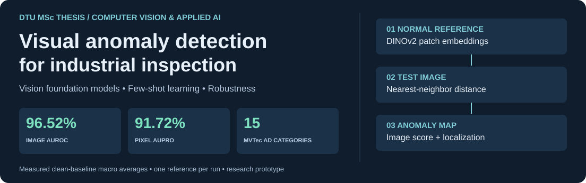
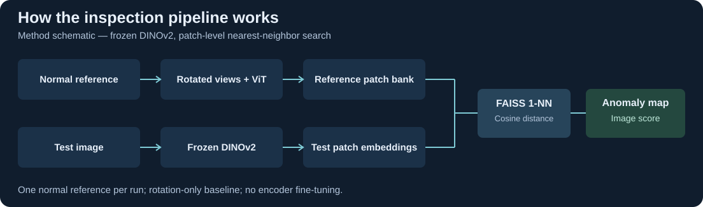
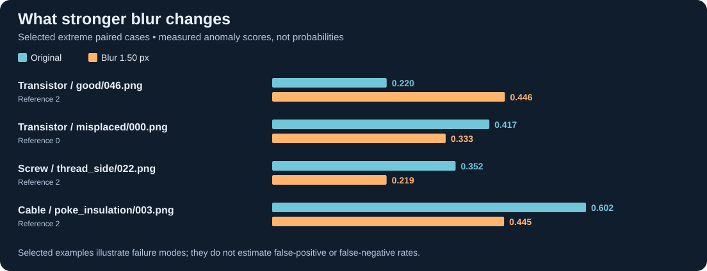

# Vision Foundation Models for Visual Anomaly Detection

**MSc thesis · Human-Centered Artificial Intelligence · Technical University of Denmark (DTU)**

Can an industrial inspection system recognize defects from only one defect-free reference image? This research investigates pretrained vision features for image-level detection and pixel-level localization, and measures how performance changes under controlled lighting and blur.

**Python · PyTorch · DINOv2 · FAISS · OpenCV · NumPy · DTU HPC / LSF**

[Results](#measured-results) · [Method](#method) · [Failure analysis](#failure-analysis) · [Explore the code](#explore-the-project) · [Reproducibility](#reproducibility)

> **Research status:** Clean baseline and full lighting/blur benchmark completed and checked. Reference-augmentation ablation and normal-only threshold calibration are in progress. Zero-shot comparison remains a scope decision. This is a research prototype, not a validated production inspection system.

## Measured results

| Condition | Image AUROC | Image AP | Image F1-max | Pixel AUROC | Pixel F1-max | Pixel AUPRO |
|---|---:|---:|---:|---:|---:|---:|
| Clean | 96.52% | 98.14% | 95.96% | 96.26% | 57.94% | 91.72% |

**Evaluation:** MVTec AD, all 15 categories, 3 deterministic reference choices per category, 45 clean runs. Each run uses one normal reference, frozen DINOv2 ViT-S/14 and 448-pixel short-edge resizing. Metrics are equal-weight category averages; AUPRO is evaluated up to a false-positive rate of 0.30. F1-max is a best-threshold summary, not a calibrated operating point.

[Baseline metrics](reports/baseline_reproduction/summary.json) · [Category-level image AUROC](reports/baseline_reproduction/figures/image_auroc.svg) · [Pixel F1-max](reports/baseline_reproduction/figures/pixel_f1max.svg) · [Provenance](reports/baseline_reproduction/provenance.json)

### Robustness under lighting changes and blur

All 180 perturbed evaluations were completed with the same test images and reference identities as the clean baseline. The strongest blur decreased image AUROC by **3.08 percentage points** and pixel AUPRO by **1.53 percentage points**. The tested brightness reductions produced much smaller aggregate changes. These are controlled synthetic perturbations, not a validation on factory production lines.

[Full results and six-metric table](reports/lighting_blur/README.md) · [Per-run CSV](reports/lighting_blur/per_run.csv) · [Category changes](reports/lighting_blur/per_category.csv) · [Protocol](protocols/lighting_blur.md)

## Method

The baseline reproduces AnomalyDINO (WACV 2025). A frozen DINOv2 encoder extracts dense patch embeddings; a bank of normal reference patches is queried with FAISS nearest-neighbor search. Patch distances yield a spatial anomaly map, while top-patch pooling produces an image score. The controlled robustness experiments perturb only the test input, leaving reference images unchanged.

The ongoing candidate study compares rotation-only reference banks with brightness, blur and combined augmentation at a fixed patch budget. No improvement is claimed until the full ablation is evaluated.

## Failure analysis

Blur can raise a normal image's anomaly score and lower scores for real defects. These selected extreme cases are useful for diagnosis, but are not estimates of error rates. Independent normal-only threshold calibration is being evaluated separately.

[Selected measured cases](reports/lighting_blur/selected_blur_cases.csv)

## Engineering skills demonstrated

| Capability | Evidence |
| --- | --- |
| Computer vision & deep learning | Frozen ViT features, patch embeddings, anomaly localization |
| ML engineering | GPU inference, CPU metric evaluation, FAISS search, modular experiment scripts |
| Experimental design | Fixed reference manifests, paired controls, controlled perturbations |
| Scientific computing | AUROC, AP, F1-max, AUPRO, category-level variation and error analysis |
| Reproducibility | Pinned upstream code, environment records, reference hashes and result provenance |

## Explore the project

| Start here | What you will find |
| --- | --- |
| [Dataset exploration](notebooks/dataset_exploration.ipynb) | Data splits, masks and initial data checks |
| [Baseline setup & smoke test](notebooks/baseline_setup_and_smoke_test.ipynb) | Initial pipeline validation |
| [Baseline reproduction](notebooks/baseline_reproduction.ipynb) | 45 clean runs, category variation and published comparison |
| [Full robustness report](reports/lighting_blur/README.md) | All 180 perturbed runs and measured changes |
| [Robustness pilot notebook](notebooks/lighting_and_blur_robustness.ipynb) | Historical Bottle validation; full results are linked above |
| [Inference](scripts/run_baseline.py) / [Evaluation](scripts/evaluate_baseline_category.py) | Core implementation and evaluation |
| [Experiment protocols](protocols/) / [HPC jobs](jobs/) | Research design and scheduler orchestration |

## Reproducibility

    git clone --recurse-submodules https://github.com/basharbd/msc-visual-anomaly-detection.git
    cd msc-visual-anomaly-detection
    # Regenerate baseline figures (Python + Matplotlib)
    python scripts/plot_baseline.py
    # Regenerate portfolio graphics (Python standard library only)
    python assets/generate_figures.py

The full inference workflow uses DTU-specific dataset, environment and checkpoint paths. It is not a one-command portable demo yet. See [environment snapshot](configs/), [reference manifest](protocols/adino_mvtec_1shot_448_references.json), [GPU array](jobs/baseline_inference_array.lsf), [CPU array](jobs/baseline_evaluation_array.lsf), and [research logs](research_logs/). Raw prediction maps and full dataset files remain on HPC; published CSVs and figures can be inspected without a DTU account.

The original AnomalyDINO implementation remains pinned in [third_party](third_party/) as a Git submodule. The thesis-specific scripts, protocols and analysis are separate from upstream. Development branches may contain ongoing work; the main branch presents verified published results.

## References and data use

- Damm et al., *AnomalyDINO: Boosting Patch-Based Few-Shot Anomaly Detection with DINOv2*, WACV 2025. [Paper](https://openaccess.thecvf.com/content/WACV2025/html/Damm_AnomalyDINO_Boosting_Patch-Based_Few-Shot_Anomaly_Detection_with_DINOv2_WACV_2025_paper.html)
- Oquab et al., *DINOv2: Learning Robust Visual Features without Supervision*. [Paper](https://arxiv.org/abs/2304.07193)
- Bergmann et al., *MVTec AD — A Comprehensive Real-World Dataset for Unsupervised Anomaly Detection*, CVPR 2019. [Official dataset and terms](https://www.mvtec.com/research-teaching/datasets/mvtec-ad)

MVTec AD data is licensed CC BY-NC-SA 4.0; the benchmark results are academic research and do not establish commercial dataset-use rights. The new portfolio graphics use original schematics and numerical results rather than redistributing dataset images. Upstream code and weights retain their own licenses.

---

**Bashar Khaled Bdewi** · MSc Human-Centered Artificial Intelligence, DTU

[GitHub profile](https://github.com/basharbd)
